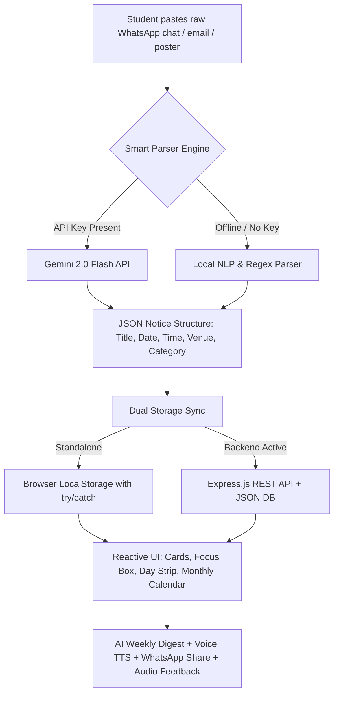

# 🎓 Campus Board — "Campus Pulse"

> **Winner-ready project for PromptWars × CSSS | Google for Developers (Build with AI Challenge)**  
> *One clear, intelligent place for students to stay on top of campus life — eliminating scattered WhatsApp notices, missed deadlines, and unclear event details.*

[](https://developers.google.com/)
[](https://aistudio.google.com/)
[](https://nodejs.org/)
[](https://expressjs.com/)
[](https://opensource.org/licenses/MIT)

---

## 📌 Problem Statement

Every college student faces the exact same daily friction:
- Important notices scattered across 15+ unorganized WhatsApp groups and class chats.
- Critical assignment deadlines and exam schedules drowned out by casual chatter (*"ok thanks"*, *"noted sir"*).
- Unclear venues, confusing time formats, and missed placement drives.
- **No single, consolidated place to see what is happening today, tomorrow, and this week.**

**Campus Board** solves this by letting students copy-paste any raw WhatsApp forward, email snippet, or event poster caption (in English or Hinglish). Using **Google Gemini 2.0 Flash** (with an offline regex fallback), it automatically extracts the title, category, date, time, and venue into structured, urgent, and actionable cards.

---

## 🚀 Key Highlights & Differentiators

| Feature | Description |
|---|---|
| 🧠 **Dual AI Engine** | Powered by **Gemini 2.0 Flash** for natural language understanding and Hinglish parsing (`"kal 5 baje seminar hall me"`). Seamlessly falls back to an offline regex engine if offline or no key is configured. |
| 💬 **1-Click WhatsApp Direct Share** | Every card has a **"💬 WhatsApp"** button that generates a pre-formatted message with emojis ready to send to classmates. |
| 🔔 **Synthesized Audio Micro-Interactions** | Built-in Web Audio API synthesizer (pop on add, victory chord on "Done", scanning chime on parse) — 100% offline with a mute toggle! |
| 🌙 **Dark & Light Mode** | Sleek dark mode toggle (`🌙 / ☀️`) with glowing borders, preserving Figtree typography and pastel aesthetics. |
| 🎨 **Dynamic Aurora & Particle Canvas** | Floating, ambient gradient blobs and interactive micro-particles that gently react to mouse movement and transition colors smoothly based on time of day. |
| ⏱ **Live Countdown & Urgency Badges** | Shows `"On the clock: <title> in 2h 15m"` (updating every 30s), weekly progress tracker, and status badges (`🔴 Due today`, `Urgent`, `Upcoming`, `Expired`). |
| 📅 **Dual View (7-Day Strip + Monthly Calendar)** | Filter by tapping individual days in the 7-day strip, or toggle a full interactive monthly calendar grid with category dots. |
| 🔊 **Voice Digest (TTS) & Ask Campus AI** | One-tap weekly summary with Web Speech API audio readout, plus a conversational assistant to answer questions like *"Can I travel home this weekend?"*. |
| 🧪 **Expanded Demo Vault (6 College Scenarios)** | One-click demo notices for Hinglish lab submissions, noisy class chats, placement drives, exam reschedules, hackathon posters, and library fines. |
| 🔌 **Dual Mode Architecture** | Runs 100% standalone by double-clicking `index.html` (using `localStorage`), OR connects to the Express Node.js backend when running locally or deployed. |

---

## 🏗 System Architecture



---

## 💻 Tech Stack

- **Frontend**: Pure HTML5, CSS3, Vanilla ES6+ JavaScript (Zero dependencies, Figtree typography, Web Audio API, CSS Keyframe Blobs + HTML5 Particle Canvas).
- **AI / LLM**: Google Gemini 2.0 Flash (`@google/genai` REST integration).
- **Backend (Optional / Standalone-ready)**: Node.js, Express.js, CORS, Dotenv.
- **Data Persistence**: Dual sync (`localStorage` + `backend/data/notices.json`).

---

## ⚡ Quickstart

### Option A: Standalone (Instant Double-Click)
No installation required!
1. Clone the repository:
   ```bash
   git clone https://github.com/your-username/campus-board.git
   cd campus-board
   ```
2. Double-click `index.html` in File Explorer, or open it in any browser (Chrome, Edge, Firefox, Safari).

### Option B: Full-Stack Mode (Node.js & Express Server)
1. Navigate to the backend directory:
   ```bash
   cd backend
   npm install
   ```
2. (Optional) Set up your Gemini API Key in `.env`:
   ```bash
   cp .env.example .env
   # Add your GEMINI_API_KEY inside .env
   ```
3. Start the server:
   ```bash
   npm start
   ```
4. Open [http://localhost:5000](http://localhost:5000) in your browser. The app will automatically show `🟢 Server Online`!

---

## 📡 REST API Documentation (Backend)

| Method | Endpoint | Description |
|---|---|---|
| `GET` | `/api/health` | Server uptime and Gemini status |
| `GET` | `/api/notices` | Fetch all notices |
| `POST` | `/api/notices` | Add notice (single object or bulk array) |
| `PUT` | `/api/notices/:id` | Update notice by ID (title, date, starred, done) |
| `DELETE` | `/api/notices/:id` | Delete notice by ID |
| `POST` | `/api/ai/parse` | Extract structured notices from messy text |
| `POST` | `/api/ai/digest` | Generate concise weekly summary digest |
| `POST` | `/api/ai/ask` | Natural language question answering about schedule |

---

## 👥 Authors & Acknowledgments

- Built by **Aditya Sharma** for **PromptWars × CSSS | Google for Developers**.
- Powered by Google Gemini 2.0 Flash.
